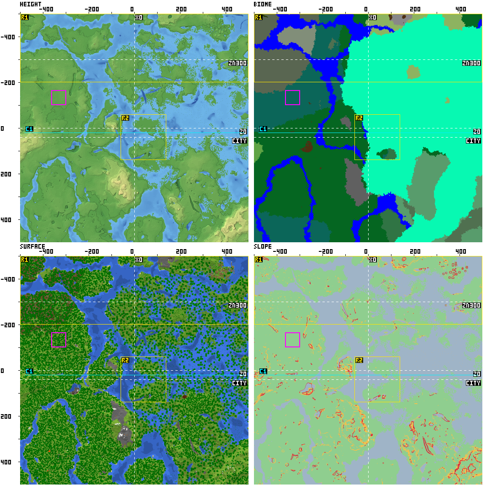
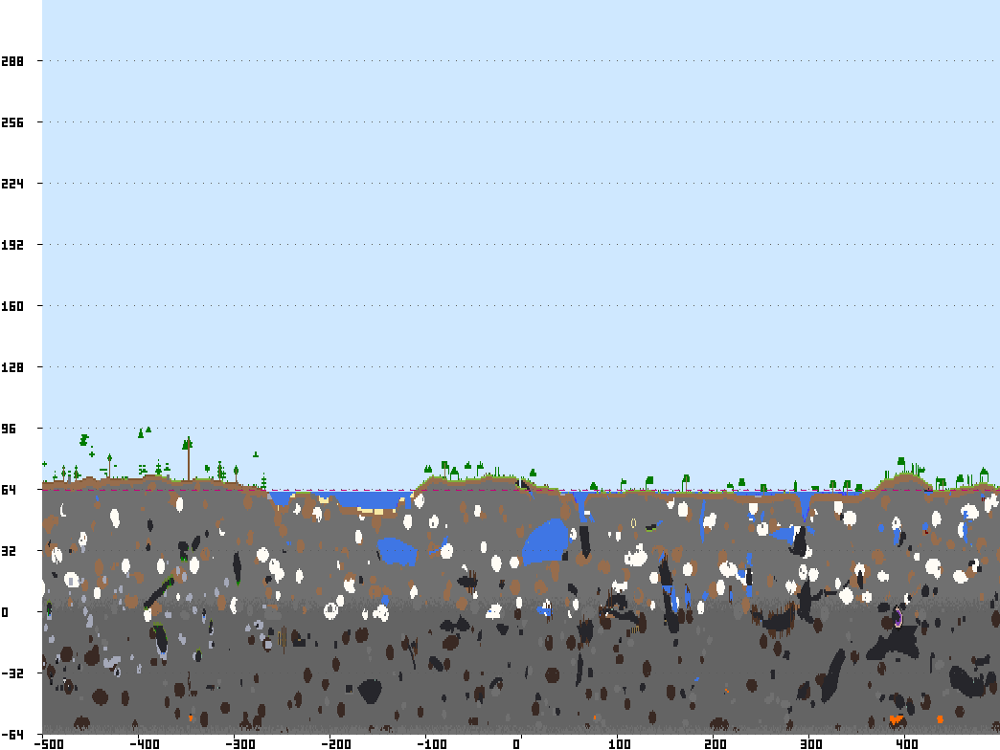
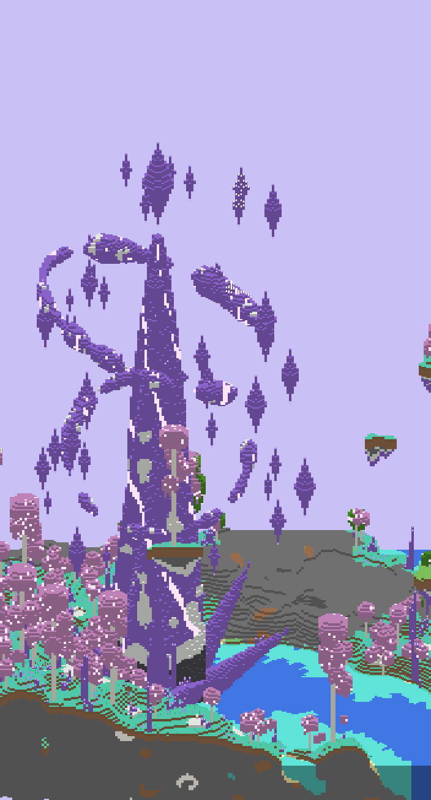
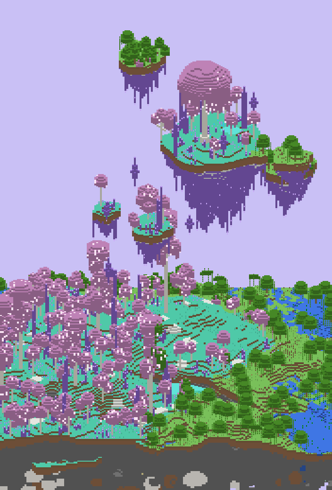
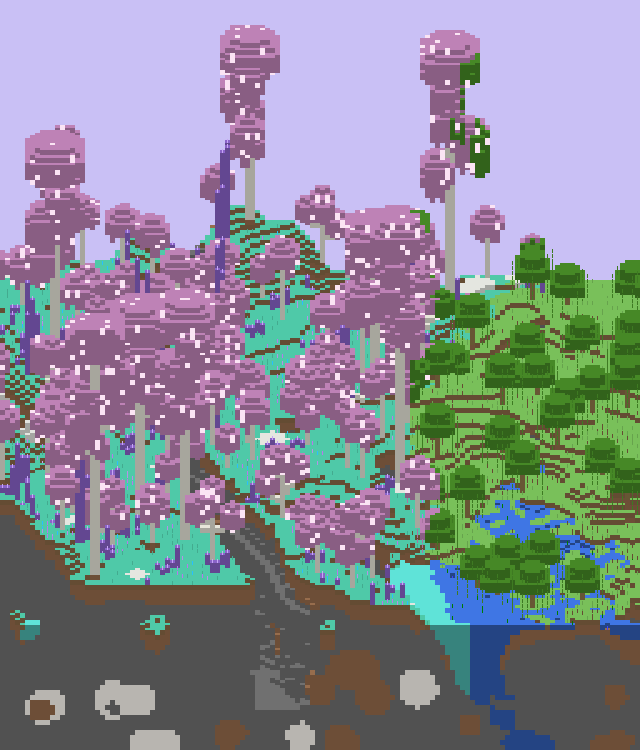

# AI 改地形数据包的闭环

> 状态（2026-11-10）：**已实现**，在 Paper 1.20.4 上端到端跑通。
> 目标版本：Java 版 **1.20.4**。给 AI 的规则在 [worldgen/AI_RULES.md](../worldgen/AI_RULES.md)。

## 0. 这是什么

AI 改世界生成数据包（JSON）→ 用**真实的 Paper 1.20.4 测试服**生成一块区域 → 导出方块、高度、群系 → 画成图、算出数字 → AI 对照验收标准再改。一轮一两分钟，全程不用人点。


不用第三方渲染器或仿真器：很多工具不支持 1.20.4，而且仿出来的和游戏实际生成的不一定一样。直接用真服务端跑，AI 看到的就是玩家会看到的。

---

## 1. 怎么用

需要 Node.js 22 和 Java 17 或更新的版本（改插件源码才需要 JDK，只用的话 JRE 就够）。

```bash
npm install
npm run worldgen:setup      # 只需要一次：下载 Paper 1.20.4、Chunky，生成原版参考文件
npm run worldgen:round      # 跑一轮
```

| 命令 | 作用 |
|---|---|
| `npm run worldgen:setup` | 准备 `worldgen-server/`（Paper 1.20.4 + Chunky + WgExport 插件）和 `worldgen/vanilla/`（原版 worldgen JSON）。可以重复运行 |
| `npm run worldgen:round` | 用 `targets.yaml` 里的主种子跑一轮，输出到 `worldgen/runs/NNNN-s种子/` |
| `npm run worldgen:round -- --seed 42` | 换一个种子跑一轮 |
| `npm run worldgen:round -- --keep-world` | 另外把生成的世界存一份到这一轮的文件夹里 |
| `npm run worldgen:verify` | 用 `verify_seeds` 里每个种子各跑一轮，汇总成一张表（`worldgen/runs/verify-latest.md`） |
| `npm run worldgen:analyze -- --run 12` | 不重新生成，按现在的 `targets.yaml` 重新算第 12 轮的数字、图和报告（改了区域、道路、检查项之后用） |
| `npm run worldgen:play -- --run 12` | 用第 12 轮的数据包和种子重新生成世界并开服，人进去看 |
| `npm run worldgen:build-plugin` | 改了 `tools/wgexport` 的源码后重新编译插件 |

`worldgen:round` 的退出码：0 = 检查全过；1 = 跑完了但有检查没过；2 = 没跑成（原因会打印出来）。

可以用环境变量调整：`WG_XMX`（服务端内存，默认 `4G`）、`WG_TIMEOUT_MIN`（一轮的超时，默认 15 分钟）、`JAVA`（java 的路径）。

**让 AI 开始干活**：在 Cursor 里打开这个仓库，告诉它"按 `worldgen/AI_RULES.md` 做，目标在 `worldgen/targets.yaml`"。仓库里的 `.cursor/rules/worldgen.mdc` 会在它碰 `worldgen/` 下的文件时自动提醒这些规则。开始之前，你要先把 `worldgen/targets.yaml` 改成自己想要的地形（现在里面是一份示例）。

### 目录

```
worldgen/
├─ targets.yaml        验收标准（人写，AI 不能改）
├─ feedback.md         人进游戏后的反馈（人写，AI 每轮必读）
├─ log.md              每轮一条：改了什么、为什么、结果如何（AI 写）
├─ AI_RULES.md         给 AI 的规则
├─ rounds.jsonl        每轮一行的记录（脚本写，用来编号和数"几轮没人看了"）
├─ datapack/           AI 改的数据包，整个文件夹会被拷进世界
├─ vanilla/            原版 1.20.4 的 worldgen JSON，只读参考（setup 生成，不进 git）
└─ runs/               每轮输出（不进 git）
   ├─ 0001-s20261109/
   │  ├─ report.md  metrics.json  server.log
   │  ├─ overview.png  height.png  biome.png  surface.png  slope.png
   │  ├─ section-<名字>.png  diff-height.png
   │  ├─ meta.json  columns.bin  palette.json  sections/*.bin   ← 插件导出的原始数据
   │  └─ datapack/           这一轮用的数据包的副本
   └─ latest.txt             最新一轮的文件夹名
worldgen-server/       地形测试服（setup 生成，不进 git），端口 25566
tools/wgexport/        导出插件（Java 源码 + 编译好的 jar）
scripts/worldgen/      setup / round / verify / analyze / play，以及画图、算指标、写报告的模块
```

地形测试服和机器人用的 `test-server/`（超平坦世界，端口 25565）是分开的，可以同时开。

---

## 2. 一轮里发生了什么（`scripts/worldgen/round.ts`）

开服之前先做三项检查，任何一项不过都不开服（退出码 2）：

1. **数据包检查**：每个 JSON 都能解析（不能有注释和多余的逗号），`pack_format` 是 26。
2. **阶段检查**：和上一轮的数据包副本比，这一轮改动的文件必须在当前阶段允许的范围里（`targets.yaml` 的 `stages`）。见第 6 节。
3. **人工把关**：`feedback.md` 没变的情况下已经跑了 5 轮，就拒绝再跑，提示先进游戏看。见第 7 节。

然后：

4. 删掉 `worldgen-server/world`，把数据包拷到 `world/datapacks/aitothemoon-worldgen/`，把种子写进 `server.properties`。数据包必须在世界创建之前放好——世界生成的设置在创建世界时就定了；种子也只在创建世界时生效。所以每轮都是全新的世界。
5. 写一个任务文件 `wgexport-job.json`，启动服务端。WgExport 插件在服务端加载完成后自动开始：生成 → 导出 → 关服。脚本只需要等进程退出（超时就强制结束）。
6. **识别失败**。1.20.4 的服务端在数据包有任何 worldgen 错误时会整个拒绝加载（不会悄悄退回原版），但**退出码仍然是 0**，所以脚本自己看日志：找到 `Registry loading errors` / `Failed to load datapacks`，把是哪个文件、什么原因（去掉 Java 堆栈）写进 `report.md`。另外还会确认导出结果里"已启用的数据包"包含我们的包，否则这一轮不算数。
7. 算指标、画图、写报告，在 `rounds.jsonl` 记一行。

失败的轮次也会占一个编号、留下 `report.md` 和 `server.log`，但不计入"几轮没人看了"。

---

## 3. 导出插件 WgExport（`tools/wgexport`）

Java 17，只依赖 Paper API。读服务端目录下的 `wgexport-job.json`（区域大小、中心、剖面线、输出目录），服务端启动完成后自动运行；也可以在控制台输入 `wgrun` 手动触发。

**生成**：装了 Chunky 就让 Chunky 生成（发 `chunky world / shape / center / radius / start` 这几条命令，然后轮询"区域里的区块是不是都生成了"，不依赖 Chunky 的提示文字；60 秒没进展就自己接手）。没装 Chunky 时，用 Paper 自带的异步区块加载生成，结果一样。setup 会把 Paper 的区块线程数调到和 CPU 核数一样（默认只用一半左右）。

**每一列导出这些**（`columns.bin`，小端，每列 10 字节，按 z 行、x 列排列）：

| 字段 | 类型 | 含义 |
|---|---|---|
| `groundY` | int16 | **地面高度**：从最高的非空气方块往下找，跳过树叶、原木、植物、雪层、所有没有碰撞箱的方块、水、岩浆、冰、巨型蘑菇、竹子、仙人掌、南瓜、西瓜，找到的第一个实心方块的 y。`targets.yaml` 的 `not_ground` 里列出的方块也会跳过（数据包用来做装饰的方块，比如树冠里的发光方块、水晶柱） |
| `waterY` | int16 | 地面上方有水（或冰）时，水面最高的 y；没有水是 −32768 |
| `topBlock` | uint16 | 从天空往下看到的第一个非空气方块（可能是树叶、雪、水），在 `palette.blocks` 里的下标 |
| `groundBlock` | uint16 | `groundY` 那个方块的下标 |
| `biome` | uint16 | 地表处的群系，在 `palette.biomes` 里的下标 |

**剖面**（`sections/<名字>.bin`）：每条剖面线上每一列从 y=−64 到 319 的全部方块。

**`palette.json`**：方块 ID 和它的地图颜色（Paper 的 `BlockData#getMapColor()`），以及群系 ID 列表。
**`meta.json`**：种子、范围、版本、用时、已启用的数据包。（里面也有一个海平面，但 1.20.4 的服务端接口不管数据包怎么写都回答 63，所以脚本实际用的海平面是从这一轮的数据包里读的：`noise_settings/overworld.json` 的 `sea_level`，没有这个文件就是 63。）
**`done.json`**：最后才写，有它才说明导出完整。出错时写 `error.json`。

几个实现上的要点：

- **群系名**用 `Bukkit.getUnsafe().getBiomeKey(...)` 取。Bukkit 的 `Biome` 枚举遇到数据包自定义群系只会返回 `CUSTOM`，用不了。
- 区块一加载完就在主线程上读（每个区块的活很少），读完不保留，内存占用是固定的。
- 方块和群系的编号按名字排序，保证同样的世界导出同样的字节。
- 村庄之类的建筑是实心方块，会算进地面高度。

---

## 4. 图和数字

### 4.1 图（1 像素 = 1 格）

| 文件 | 内容 |
|---|---|
| `overview.png` | 下面四张缩小一半拼成 2×2，边上有坐标。白色虚线 = 剖面线，洋红方框 = 最大可建平地，黄色框 = 区域（R1、R2…），青色线 = 道路（C1…）。**AI 主要看这张** |
| `height.png` | 高度图：按高度上色 + 阴影 + 每 16 格一条等高线；水是蓝色，越深越暗 |
| `biome.png` | 群系图：原版群系用固定颜色，自定义群系按名字算出一个颜色；颜色对照表在 `report.md` 里 |
| `surface.png` | 俯视地表：用方块的地图颜色，接近游戏里地图的样子 |
| `slope.png` | 坡度：绿 = 平缓，黄 = 陡坡，红 = 悬崖，灰蓝 = 水 |
| `section-<名字>.png` | 剖面：横轴是沿线坐标，纵轴 y（纵向放大 2 倍），洋红虚线是海平面，深色是洞穴 |
| `diff-height.png` | 和同一个种子的上一轮比，地表高度变高的地方红、变低的地方蓝、没变的白 |

图里的文字只能显示英文字母和数字，所以区域和道路在图上标成 R1、C1，对应的名字在 `report.md` 的表里。

原版地形（空数据包，种子 20261109）跑出来的 `overview.png`：



同一轮里 z=−300 的剖面：



### 4.2 指标（`metrics.json`）

几个词的意思：**陆地** = 上面没有水的列；**地表高度** = 地面高度，有水时取水面；**坡度** = 一列和它上下左右四格的地表高度差里最大的那个。

| 指标 | 定义 |
|---|---|
| `ocean_share` | 群系属于 `#minecraft:is_ocean` 的列占比（原版标签 + 数据包里对这个标签的修改） |
| `river_share` | 群系属于 `#minecraft:is_river` 的列占比 |
| `water_share` / `land_share` | 有水的列 / 陆地的占比（海、河、湖都算水） |
| `flat_share` | 陆地中坡度 ≤ 1 的占比 |
| `steep_share` | 陆地中坡度 2–3 的占比 |
| `cliff_share` | 陆地中坡度 ≥ 4 的占比 |
| `land_height.min / p5 / p25 / p50 / p75 / p95 / max / mean` | 陆地地面高度的分布 |
| `land_height_histogram` | 陆地高度每 16 格一档的占比 |
| `relief` | 陆地最高点减最低点 |
| `biome_share.<群系ID>` | 每个群系的占比（没出现的群系算 0） |
| `group_share.<组名>` | `targets.yaml` 里 `groups` 定义的群系组的占比 |
| `top_biome` | 占比最大的群系 |
| `largest_flat_square.size / x / z / y` | 最大的"可建平地"正方形的边长和中心：里面每一列都是陆地、不低于海平面、坡度 ≤ 1，且整块高差不超过 `flat_square.max_relief`（默认 4） |
| `largest_landmass_share` | 最大一块连通的陆地占全部陆地的比例（防止碎成一堆小岛） |
| `regions.<名字>.<…>` | 每个矩形区域单独算一套：上面从 `ocean_share` 到 `top_biome` 的所有指标 |
| `corridors.<名字>.max_step` | 道路沿线相邻两格的最大高差 |
| `corridors.<名字>.total_climb / total_descent / relief` | 沿线总爬升、总下降、最高减最低 |
| `corridors.<名字>.longest_steep_run` | 最长一段连续的陡坡（相邻高差 ≥ 2）有几格 |
| `corridors.<名字>.max_cross_relief` | 路面宽度方向上的最大高差 |
| `corridors.<名字>.water_share` | 路面有水的比例 |
| `points.highest` / `points.steepest` | 最高点、最陡处的坐标（给人进游戏看用） |

道路的高度取路面宽度内的中位数，所以路中间有一棵树或一个小坑不影响结果。

### 4.3 报告（`report.md`）

第一行是结论（通过，或者哪几项没达标）。后面依次是：验收表（目标、本轮、上一轮、变化、结果）、关键数字和变化、陆地高度分布、群系占比、区域和道路的表、值得进游戏看的地方（现成的 `/tp` 指令）、图的说明、数据包和上一轮的文件差别。

"上一轮"指同一个种子上一次成功的那一轮。

---

## 5. 验收标准 `targets.yaml`

人来写，AI 只读。仓库里的 [worldgen/targets.yaml](../worldgen/targets.yaml) 是一份带注释的示例，里面有：

- `goal`：用人话写想要什么。
- `seed` / `verify_seeds`：日常用的种子、定稿前验证用的种子。
- `area`：测试区域的中心和边长。
- `current_stage` / `stages`：分层做的阶段，见第 6 节。
- `sections`：剖面线。
- `not_ground`：不算地面的方块。树叶、原木、植物本来就不算；数据包里用别的方块做装饰时要列在这里，不然会被当成地形。
- `groups`：群系组，比如把四种雪山群系合成"雪山"。
- `regions` / `corridors`：单独算数字的矩形区域和道路。
- `checks`：检查项，每项是"某个指标 ≥ / ≤ 某个值"，`stage` 表示从第几阶段开始算数。

写标准时注意：**能加上限的都加上限**（比如平地比例 35%–70%），不然 AI 最省事的办法就是把整个世界压平。只写"好看"的话，AI 没法稳定判断，要写成"雪山占 25%–35%""主路沿线每格高差 ≤ 3"这样能量出来的话。

---

## 6. 几条规则，都由脚本强制执行

**分层做。** 先定大地形，再做地表方块、群系、树和装饰。一次全改，就不知道是哪项改动造成的变化。`targets.yaml` 的 `stages` 给每个阶段列出能改的文件（还可以用 `only_keys` 限制到文件里的某几个字段，比如第 2 阶段只能改 `overworld.json` 的 `surface_rule`）。改了别的，这一轮不跑。进入下一阶段要人来改 `current_stage`。

**换种子验证。** 一个种子好看可能只是运气。`npm run worldgen:verify` 用 3 个种子各跑一轮，全部通过才算这个阶段完成。

**先写假设。** AI 每轮动手前在 `log.md` 写下"改什么、预计哪个数字怎么变"，跑完对照。配合 `diff-height.png`，能看清每次改动到底影响了哪里。

**同样的输入，结果基本一样，但不是一模一样。** 同一个数据包、同一个种子跑两次：群系完全一样；地形只有极少数位置不同（实测 100 万列里不到 200 列）；树叶、花草这类顶层方块大约 2% 的位置不同。原因是 Minecraft 多线程生成时，相邻区块放装饰的先后顺序不固定。实测两次的指标只在小数点后第 4 位有差别，所以占比类的数字差 0.1 个百分点以内当作没变（报告里也是这样显示的）。把区块线程数降到 1 可以把这种差异再缩小几十倍，但仍然不是零，而且慢 3 倍，所以没有这么做。

---

## 7. 人工把关

俯视图和剖面图只能看布局，看不出玩家站在地上的感觉。所以每 5 轮（`human_check_every`）必须有人进游戏走一圈，不然脚本拒绝继续跑。

1. `npm run worldgen:play -- --run 12`：用第 12 轮的数据包和种子重新生成世界，开服并保持运行。窗口里会打印值得看的地方的 `/tp` 指令（最大平地、最高点、最陡处、每个区域的中心、道路两端、剖面线中点）。
2. 用 1.20.4 客户端连 `127.0.0.1:25566`。服务器只监听本机，别人连不上；进服是创造模式。想飞着看，在开服的窗口里输入 `op <你的名字>`，然后在游戏里 `/gamemode spectator`。
3. 看完在开服的窗口输入 `stop`。
4. 把看到的问题写进 `worldgen/feedback.md`，越具体越好。文件内容一变，5 轮的计数就清零。
5. 遇到满意的一轮，在 `feedback.md` 里写"参考轮：12"，之后 AI 改的时候要拿那一轮的图对比。

**最大的风险是 AI 把数字越调越达标，地形却越来越没意思。** 所以 `feedback.md` 的优先级高于 `targets.yaml` 的数字，AI 不能改验收标准和指标算法，最终拍板的是人。

---

## 8. 数据包里现在有什么：紫晶林

`worldgen/datapack/` 里现在有一个奇幻群系 `aitothemoon:crystal_grove`（紫晶林），是用这套流程做出来的，过程记在 `worldgen/log.md`。

下面三张图都是把导出的方块按颜色值画出来的斜视图，不是游戏截图。

| 天穹晶塔 | 浮空群岛 |
|---|---|
|  |  |



**林子本身**

- 白色树干（白桦原木）配粉紫色树冠，树冠里夹着发光的珠光蛙明灯。
- 林间有成簇的紫水晶柱，偶尔有 8–22 格高的水晶尖塔；地上有方解石斑块、紫色和青色的小花、水晶芽。
- **参天巨树**：30–56 格高、2×2 粗树干、挂着成串大树冠的巨树，大约每两个区块一棵。
- 草是青绿色，水是青色，天空和雾偏紫，空气里有飘浮的光点。

**巨型结构**

- **天穹晶塔**（`crystal_spire`）：约 220 格高的扭转六棱水晶巨塔，塔顶能到 y=300 附近。根部是玄武岩和方解石外壳，塔身有三条螺旋上升的发光脉；底部有斜插出来的巨型晶簇；周围有两道倾斜的破碎光环和三十颗悬浮晶体；塔尖上方悬着一颗巨晶。稀有：可能出现的位置平均隔 320 格，而且那个位置得正好在紫晶林里，所以不是每片林子都有。
- **浮空群岛**（`sky_isles`）：悬在地面上方 40–170 格的六座岛。岛底是方解石和紫水晶，挂着水晶钟乳；主岛上有一棵三十多格高的发光巨树和一个水池，水从缺口漫出岛沿。常见：平均隔 144 格。它会避开晶塔可能出现的位置（96 格以内），免得岛和塔身穿插。

**出现在哪**：原版会生成"原始桦木森林"的地方全部换成紫晶林，所以它是成片出现的稀有群系。四个种子的 1000×1000 区域里占比从 0.07% 到 6.4% 不等。

**文件**（都在 `worldgen/datapack/data/` 下面）：

| 内容 | 位置 |
|---|---|
| 群系 | `aitothemoon/worldgen/biome/crystal_grove.json` |
| 树、水晶柱、花 | `aitothemoon/worldgen/configured_feature/`、`placed_feature/` |
| 巨型结构的模板（每块最多 48×48×48） | `aitothemoon/structures/`，由脚本生成，不要手改 |
| 巨型结构的拼接、出现规则 | `aitothemoon/worldgen/template_pool/`、`structure/`、`structure_set/`、`tags/` |
| 群系出现的位置 | `minecraft/dimension/overworld.json`（原版的完整群系参数表，只把原始桦木森林那 76 条换了名字） |

**巨型结构怎么来的**：不是在游戏里手搭的，是 `scripts/worldgen/structures/crystal-grove.ts` 按数学形状算出每个方块，再由 `scripts/worldgen/structures/kit.ts` 切成最多 48×48×48 的模板、用拼图方块连起来，游戏生成时再拼回完整形状。改了形状后运行 `npm run worldgen:build-structures` 重新生成。游戏的限制：每块模板必须在起始块底部上下左右 128 格以内，离起始块最多 7 次连接。

**导出时的注意点**：浮空岛是实心的石头和草方块，会被算进"地面高度"，和村庄一样。全图的最高点、悬崖比例会因此略高。

**不想要它**：把 `worldgen/datapack/data/` 整个删掉，数据包就回到空的（原版地形）。

**没验证的**：

- 颜色和粒子只有进游戏才能看到。
- 主岛的瀑布：水要在玩家靠近、开始流动之后才会倾泻下来，导出里只确认了水池里有水。
- 树冠里的蛙明灯会不会让少量树叶慢慢枯萎（结构里的树叶不会，林子里自然生成的树可能会）。
- 巨型结构对服务器性能的影响：一座晶塔约 15 万个方块，生成时会比普通区块慢，没有专门测过。

进游戏看：`npm run worldgen:play`，种子 20261109 上，林子最密的地方在 `/tp @s 270 90 270`，浮空群岛在 `/tp @s 304 200 176`，最近的晶塔在 `/tp @s -576 200 -1264`（在 1000×1000 的测试区域外面，走到那里时会现场生成）。也可以用 `/locate structure aitothemoon:crystal_spire` 找。

---

## 9. 实测情况和没验证的部分

在 4 核、Java 21 的 Linux 机器上实际跑过的：

- `npm run worldgen:setup` 从零开始约 25 秒（不含 Chunky）。
- 1000×1000 的一轮共约 70 秒，其中生成 50 秒（没有 Chunky，4 个区块线程）。
- 同一个数据包和种子连跑两次，结果的差异见第 6 节。
- 改了海平面的一轮：报告里的对比、高度差图、数据包差别都正确。
- 数据包写错的几种情况（JSON 语法错、字段类型错、引用了不存在的东西、装饰写错）服务端都会拒绝加载，脚本能识别并把原因写进报告。
- 越阶段改文件被拒绝；连续几轮没有反馈被拒绝；`worldgen:verify` 三个种子出汇总表；`worldgen:analyze` 重新分析。
- `worldgen:play` 开服、生成、打印传送坐标、接受控制台指令、关服；用程序模拟的 1.20.4 客户端能连进去（创造模式）。
- 单元测试 `test/worldgen.test.ts`（`npm test`）用手造的小地图验证指标：一块平地、一道悬崖、一片海、一条有台阶的路等。

**没有验证的**：

- **Chunky**。写代码的环境下载不了 Chunky，所以"让 Chunky 生成"这条路没有实际跑过；实际跑过的是没有 Chunky 时的自带生成。Chunky 这条路写得很保守（不依赖它的接口和提示文字，卡住会自动换成自带生成），但第一次在你机器上跑时请留意日志里有没有 `Chunky: n/N chunks` 的进度，以及报告"用时"那一行写的是不是 Chunky。
- **setup 里下载 Chunky 的那一步**（从 Modrinth 取支持 1.20.4 的最新版并校验）同样没有实际跑通过。下载失败只会提示一句，不影响后面的步骤；也可以手动把 jar 放进 `worldgen-server/plugins/`。
- **Windows 和 macOS**。脚本没有用到只有 Linux 才有的东西，但只在 Linux 上跑过。
- **用真正的游戏客户端进服**。只用程序模拟的客户端连过。
- **让 AI 按规则连续改很多轮**。流水线的每一步都测过，但还没有让 AI 真的从原版开始调出一个达标的地形。

---

## 10. 参考：1.20.4 世界生成的文件在哪

AI 改之前先在 `worldgen/vanilla/` 里找到对应的原版文件，复制到 `worldgen/datapack/` 的同一路径再改，不要从零写。

| 想改什么 | 文件（都在 `data/minecraft/` 下面） |
|---|---|
| 海平面、地下含水层、地表方块规则（`surface_rule`）、噪声路由 | `worldgen/noise_settings/overworld.json` |
| 大陆度、侵蚀度、山脊、地形高低起伏（`offset` / `factor` / `jaggedness` 的样条） | `worldgen/density_function/overworld/*.json` |
| 各种噪声的频率和振幅 | `worldgen/noise/*.json` |
| 群系分布（哪种气候参数出哪个群系） | `dimension/overworld.json`：`biome_source` 里写明每个群系的参数。原版的完整参数表在 `worldgen/vanilla/reports/biome_parameters/minecraft/overworld.json` |
| 单个群系的颜色、降水、生物、装饰列表 | `worldgen/biome/<名字>.json` |
| 树、矿、花草等装饰 | `worldgen/configured_feature/`、`worldgen/placed_feature/` |

自定义的新群系、新装饰放在 `data/aitothemoon/` 下面。原版参考文件是用 Mojang 自带的数据生成器从原版 1.20.4 服务端里导出来的，和游戏内置的完全一致。
