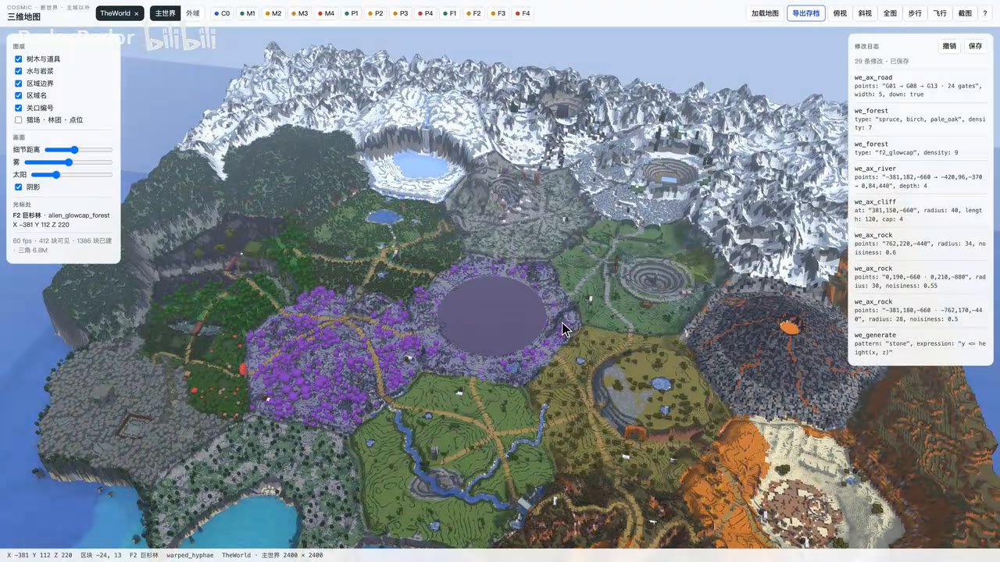
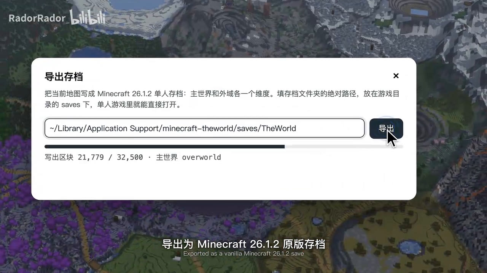

# 视频拆解：「给AI用的Minecraft实时地图编辑器」(TheWorld / mapedit MCP)

- 来源：Bilibili `BV18p4M6CE6Y`，UP 主 RadorRador，2026-11-03 发布，时长 3:10
- 简介原文：*这是由 Claude Opus5.5 制作的 rust 实时地图编辑器，为 Agent 提供 MCP 服务，让 AI 可以直接生成、修改 Minecraft 地形，并且支持实时展示和导出地图。视频编排也由 Opus5.5 完成。当前在接入创世神和 axiom 模组的类似能力，后续可能考虑开源或者提供服务。*
- 分析方式：下载 720p 视频 → 每 3 秒抽一帧（共 63 帧）拼成时间线图 → 把左侧 Agent 面板裁出放大 2 倍逐条读 → 单独截取编辑器 UI 帧和导出对话框帧。
- 关键帧存放在 `docs/frames/`。

> 下文中，**【看到】** 表示画面上明确出现的信息，**【推断】** 表示根据画面做的技术推断。

---

## 1. 视频时间线（逐段）

| 时间 | 画面 | 字幕 |
|---|---|---|
| 0:00–0:08 | 片头：蓝色光环 → 网格地面，左侧是终端风格的 Agent 面板，用户正在输入提示词 | TheWorld · 实时 Minecraft 地图编辑器 |
| 0:08–0:14 | 网格上画出六边形分区 | 以自然语言描述需求，Agent 经 MCP 驱动编辑器 |
| 0:14–0:18 | 19 个六边形区域铺满地图 | 规划 19 个六边形区域，覆盖 2400 × 2400 方块 |
| 0:18–0:25 | 地形从网格中"长"出来 | we_generate 生成地形基底，编辑结果实时渲染；地形基底约 10.9 亿个方块 |
| 0:25–0:35 | 北部雪山 | we_ax_rock 与 we_ax_sculpt 塑造北部雪峰 |
| 0:35–0:47 | 冰湖、红色台地、露天矿坑 | 切削断层峡谷，开挖露天矿坑 |
| 0:47–0:55 | 河流与海岸 | 水系自冰瀑湖贯通至南部海岸；海域沿海岸线填充 |
| 0:55–1:00 | 紫色森林 | 植被分布：13,240 棵树 |
| 1:00–1:05 | 道路 | 道路网络连通各区关口 |
| 1:05–1:09 | 风车、化石等 | 地标结构逐层放置：风车、骨脊、巨菇王 |
| 1:09–1:14 | 切到第二个世界（红色网格） | 构建第二个世界：下界外域，1600 × 1600 |
| 1:14–1:23 | 两个世界逐区细化 | 逐区细化地表，编辑器同步刷新 |
| 1:23–1:57 | 成品航拍（编辑器渲染，带体积雾/夕阳） | 两个世界，共约 14.7 亿个方块；画面中的每次调用均为 mapedit MCP 的真实工具；222 个编辑工具：WorldEdit 命令集与 Axiom 式笔刷 |
| 1:57–2:05 | **编辑器本体 UI**（见第 3 节） | 导出至原版 Minecraft |
| 2:05–2:10 | 导出对话框 | 导出为 Minecraft 26.1.2 原版存档 |
| 2:10–2:15 | 原版 Minecraft 主菜单 → 进入单人存档 | 单人模式直接载入，无需服务器 |
| 2:15–3:00 | 游戏内飞行镜头 | 进入游戏，自风车草地升空；与编辑器中的地图逐方块一致；Minecraft 26.1.2 实机画面 · 128 区块视距（Replay Mod 逐帧渲染） |
| 3:00–3:10 | 结尾数据卡 | 2 世界（2400² + 1600²）· 1,471,758,851 方块 · 222 编辑工具 · 23 区域 · 29 关口 · 13,240 树木 · 23,309,323 水方块 |

---

## 2. Agent 面板：完整的工具调用记录【看到】

面板样式是在模仿 Claude Code 的终端界面（`esc to interrupt`、任务清单打勾、`· mapedit (MCP)` 标注）。右上角显示当前世界：`world/main · 2400 × 2400`，切到外域时变成 `world/outlands · 1600 × 1600`。底部状态栏：`调用次数 | 方块总数 | 树木数 | 耗时`。

### 2.1 提示词与计划

```
> Build an alien canyon world on a 2400 × 2400 map: snow ridges up north, a fault
  canyon and open-pit mines, rivers running down to a southern sea, purple forests
  in the west, and a nether outlands next door.

● I'll lay the zones out first, then build the terrain in passes: base, ridges,
  canyons, water, forests, roads, landmarks.

Todo:
  ☐ Lay out 19 zones on a hex grid
  ☐ Base heightfield
  ☐ Ridges and snow peaks
  ☐ Fault canyon and open-pit mines
  ☐ Rivers and the southern sea
  ☐ Forests and roads
  ☐ Landmarks and the outlands
  ☐ Detail passes
```

### 2.2 调用序列（从放大帧中读出）

| # | 工具 | 参数 | 返回 |
|---|---|---|---|
| 1 | `we_ax_ruler` | points: `"0,40,-254 → 220,40,-127 → 220,40,127 → …"`, mark: true | 19 zones · 29 gates · 28,957 blocks of border |
| 2 | `we_listchunks` | world: `"main"` | 22,500 chunks |
| 3 | `we_generate` | pattern: `"stone"`, expression: `"y <= height(x, z)"` | 1,086,522,845 blocks |
| 4 | `we_ax_rock` | points: `"-381,180,-660 → -762,170,-440"`, radius: 28, noisiness: 0.5 | 70,254,147 blocks |
| 5 | `we_ax_rock` | points: `"0,190,-660 · 0,210,-880"`, radius: 30, noisiness: 0.55 | 28,228,748 blocks |
| 6 | `we_ax_sculpt` | points: `"-381,170,-660 · 381,150,-220"`, radius: 24, strength: 3 | 28,342,723 blocks |
| 7 | `we_ax_rock` | points: `"762,220,-440"`, radius: 34, noisiness: 0.6 | 43,475,271 blocks |
| 8 | `we_ax_sculpt` | points: `"outer ring · 96 pts"`, radius: 40, strength: 2 | 42,696,006 blocks |
| 9 | `we_ax_cliff` | at: `"381,150,-660"`, radius: 40, length: 120, cap: 4 | 2,434,363 blocks removed |
| 10 | `we_ax_shatter` | at: `"-762,118,0"`, radius: 36, scale: 0.22 | 1,258,193 blocks removed |
| 11 | `we_cyl` | pattern: `"air"`, radii: [96, 96], height: 64 | 6,357,401 blocks removed |
| 12 | `we_ax_extrude` | at: `"381,115,-220"`, direction: `"down"`, count: 6, shrink: true | 4,264,400 blocks removed |
| 13 | `we_ax_extrude` | at: `"0,175,-880"`, direction: `"down"`, count: 9, shrink: true | 9,335,104 blocks removed |
| 14 | `we_ax_river` | points: `"-381,182,-660 → -420,96,-370 → 0,84,440"`, depth: 4 | 72,755 water blocks |
| 15 | `we_ax_flood` | at: `"0,62,880"`, pattern: `"water"`, horizontal: true | 23,236,568 water blocks |
| 16 | `we_forest` | type: `"f2_glowcap"`, density: 9 | 405 trees |
| 17 | `we_forest` | type: `"spruce, birch, pale_oak"`, density: 7 | 7,671 trees |
| 18 | `we_ax_stamp` | count: 900, spacing: 24, ground: true | 5,164 trees |
| 19 | `we_ax_road` | points: `"G01 → G08 → G13 · 24 gates"`, width: 5, down: true | 121,135 road blocks |
| 20 | `we_schem_load` | schematic: `"windmill_big"` | 4,851 blocks |
| 21 | `we_paste` | at: `"-36,98,464"` | 5,074 blocks |
| 22 | `we_schem_load` | schematic: `"fossil_spine_giant"` | 4,909 blocks |
| 23 | `we_paste` | at: `"361,94,763"` · +4 bones | 4,909 blocks |
| 24 | `we_paste` | f2_king · pale_great_tree · deeproot_giant | 25,013 blocks |
| 25 | `we_paste` | 58 landmarks | ~108,000 blocks |
| — | *"Main world is up. Now the outlands."* | | |
| 26 | `we_generate` `[outlands]` | world: `"outlands"`, pattern: `"netherrack"`, expression: `"y <= height(x, z)"` | 385,236,006 blocks |
| 27 | `we_ax_fluid` `[outlands]` | kind: `"lava"`, at: `"0,37,0"`, length: 400 | 3,459,579 lava blocks |
| 28 | `we_forest` `[outlands]` | type: `"crimson_fungus, warped_fungus"`, density: 8 | 2,058 trees |
| 29 | `we_paste` `[outlands]` | fortress_x0 · 30 ruins and bones | 13,793 blocks |
| 30+ | 外域细化 | `we_ax_paint` / `we_flora` / `we_ax_noise` / `we_ax_stamp` / `we_overlay` / `we_ax_roughen`，均为 `at: "x,y,z", radius: 220` | 每次几十万列 |
| — | *"Both worlds are in. Running detail passes zone by zone."* | | |
| 40–75 | 主世界逐区细化 | 同上组合，每个区一轮 paint → flora → noise → stamp → overlay → roughen | 每次约 16.7 万列 |
| — | *"Done. Two worlds, 23 zones, 29 gates."* | 共 **75 次 MCP 调用** | |

### 2.3 从调用记录里能看出的设计要点【推断】

1. **工具命名两套体系**：`we_*` = WorldEdit 命令（`//generate`、`//cyl`、`//paste`、`//schem load`、`//forest`、`//flora`、`//overlay`、`//listchunks`）；`we_ax_*` = Axiom 风格笔刷（ruler、rock、sculpt、cliff、shatter、extrude、river、flood、fluid、stamp、road、paint、noise、roughen）。合计 222 个。
   注意：作者说"在接入创世神和 axiom 模组的**类似能力**"，也就是在自己的 Rust 引擎里**重新实现**这些操作，并不是调用游戏里的 WorldEdit 插件或 Axiom 模组。
2. **坐标用紧凑字符串**：`"x,y,z"`、路径 `"a → b → c"`、多点 `"a · b"`。省 token，也方便模型书写。
3. **语义锚点层**：第一步 `we_ax_ruler ... mark: true` 不只是测量，它把六边形区域和关口（gates）登记成**有名字的对象**。之后道路直接写 `"G01 → G08 → G13"`，树种写 `"f2_glowcap"`（F2 区专属），UI 里有区域标签 `C0 M1–M4 P1–P4 F1–F4`，状态栏显示 `F2 巨杉林 · alien_glowcap_forest`。这是整套系统**最关键的设计**：让 LLM 用"区域/关口/地标"这些名字来思考，而不是在 2400×2400 的坐标里盲操作。
4. **六边形网格**：区域中心坐标为 `(0,-254)`、`(220,-127)`、`(220,127)`，间距 254；细化阶段的中心为 `(±381, -660)`、`(0, -880)`、`(762, -440)` 等，每区处理半径 220。
5. **表达式语言**：`y <= height(x, z)`，其中 `height` 很可能是根据区域布局 + 噪声预先算好的高度场函数（和 WorldEdit 的 `//generate` 表达式语法一致，但自带地形函数）。
6. **返回值极简**：每次调用只返回一个计数（"28,342,723 blocks"），不返回大块数据，节省上下文。
7. **多世界**：每个工具都接受 `world` 参数（`main` / `outlands`），面板上用彩色标签 `[outlands]` 区分。
8. **结构库**：`windmill_big`、`fossil_spine_giant`、`f2_king`、`pale_great_tree`、`deeproot_giant`、`fortress_x0` 等预制结构（大概率是 Sponge `.schem` 格式），先 `schem_load`，再 `paste`。
9. **吞吐量**：17 亿方块级别的操作在几十秒内完成（面板计时 01:17）。说明引擎是内存中的区块存储 + 多线程并行（Rust 的 rayon 之类）。面板计时也可能是剪辑后加速的。

---

## 3. 编辑器本体 UI（2:02 那一帧）【看到】



- **顶栏左**：`COSMIC · 新世界 · 主城以外` / `三维地图`；存档标签 `TheWorld ×`；维度切换 `主世界 | 外域`；区域快捷芯片 `C0 M1 M2 M3 M4 P1 P2 P3 P4 F1 F2 F3 F4`（带颜色点）
- **顶栏右**：`加载地图` `导出存档` `俯视` `斜视` `全图` `步行` `飞行` `截图` `?`
- **左侧面板**
  - 图层：☑树木与道具 ☑水与岩浆 ☑区域边界 ☑区域名 ☑关口编号 ☐猎场·林团·点位
  - 画面：细节距离 / 雾 / 太阳（滑块）、☑阴影
  - 光标处：`F2 巨杉林 · alien_glowcap_forest`，`X -381 Y 112 Z 220`
  - 性能：`60 fps · 412 块可见 · 1386 块已建 · 三角 6.8M`
- **右侧面板 · 修改日志**：`29 条修改 · 已保存`，按钮 `撤销` `保存`；每条记录就是一次 MCP 调用（`we_ax_road`、`we_forest`、`we_ax_river`、`we_ax_cliff`、`we_ax_rock`、`we_generate`……带完整参数）
- **底部状态栏**：`X -381 Y 112 Z 220 · 区块 -24,13 · F2 巨杉林 · warped_hyphae · TheWorld · 主世界 2400 × 2400`

**导出对话框**：



- 说明文字："把当前地图写成 Minecraft 26.1.2 单人存档：主世界和外域各一个维度。填存档文件夹的绝对路径，放在游戏目录的 saves 下，单人游戏里就能直接打开。"
- 路径：`~/Library/Application Support/minecraft-theworld/saves/TheWorld`（macOS，单独的游戏目录）
- 进度：`写出区块 21,779 / 32,500 · 主世界 overworld` → `level.dat` → `✓ 已导出 TheWorld，主世界 22,500 区块 · 外域 10,000 区块 · 52 个区域文件 · 127 MB`，按钮 `在 Finder 中显示`

数字验证：2400/16 = 150，150² = 22,500 ✓；1600/16 = 100，100² = 10,000 ✓。区域文件：主世界以原点为中心 ±1200，覆盖 region −3..2，即 6×6 = 36 个；外域 ±800，覆盖 −2..1，即 4×4 = 16 个；36 + 16 = **52** ✓。所以地图是以 (0,0) 为中心的。

### UI 透露的技术信息【推断】

- **界面像网页**：原生 HTML 复选框和滑块的样式，加上浅色主题。大概率是 **Tauri（Rust 后端 + WebView 前端）**，或者 Rust 服务端 + 浏览器页面。3D 部分用 WebGL/WebGPU（three.js 或自写）。
- **按区块网格化**："412 块可见 · 1386 块已建 · 三角 6.8M" 说明渲染器把区块（或 16³ 子区块）分别生成网格，有视锥剔除，并按"细节距离"做 LOD。6.8M 三角形能跑 60fps，应该用了面剔除或贪心合并（greedy meshing）。
- **实时同步**：MCP 调用修改世界后，把脏区块推给前端重建网格（WebSocket 或 Tauri IPC 事件）。
- **修改日志 = 操作日志 + 撤销**：每次工具调用都是一条可撤销的事务。"已保存"说明有项目文件格式（存的可能是操作日志，也可能是区块快照）。
- **方块贴图**：画面用的是原版 Minecraft 贴图。贴图版权归 Mojang，正规做法是运行时从用户本机的 client jar 中读取。
- **游戏内镜头**：用 Replay Mod 逐帧渲染，128 区块视距超过原版上限，可能配合了 Distant Horizons 或 Voxy 之类的远景模组。这只是做视频用的，和编辑器本身无关。
- **左侧 Agent 面板**：作者说视频编排也由 Opus 完成，所以这个面板很可能是根据真实调用日志**重新排版回放**的动画（Remotion/HTML 动画之类），不一定是实时录屏。

---

## 4. 整体架构还原【推断】

```
┌──────────────┐   MCP (stdio / streamable HTTP)   ┌─────────────────────────────────────┐
│ Claude Code  │ ───────────────────────────────▶  │            mapedit (Rust)           │
│  / 任意 Agent │ ◀── 精简文本结果 "N blocks" ──────  │                                     │
└──────────────┘                                    │  ┌───────────┐   ┌───────────────┐  │
                                                    │  │ 工具层 222 │──▶│ 操作引擎       │  │
                                                    │  │ we_* /    │   │ pattern/mask/ │  │
                                                    │  │ we_ax_*   │   │ expression    │  │
                                                    │  └───────────┘   │ rayon 并行     │  │
                                                    │        │         └──────┬────────┘  │
                                                    │  ┌─────▼──────┐  ┌──────▼────────┐  │
                                                    │  │ 语义层      │  │ 世界存储       │  │
                                                    │  │ 区域/关口/  │  │ 多世界 × 区块  │  │
                                                    │  │ 地标/群系   │  │ 调色板压缩     │  │
                                                    │  └────────────┘  └──────┬────────┘  │
                                                    │  ┌────────────┐         │ 脏区块     │
                                                    │  │ 操作日志    │◀────────┤           │
                                                    │  │ 撤销/保存   │         ▼           │
                                                    │  └────────────┘  ┌───────────────┐  │
                                                    │  ┌────────────┐  │ 网格化 + LOD   │  │
                                                    │  │ Anvil 导出  │  └──────┬────────┘  │
                                                    │  │ .mca/level │         │ IPC/WS    │
                                                    │  └────────────┘         ▼           │
                                                    │                 ┌───────────────┐   │
                                                    │                 │ WebView 3D 视图│   │
                                                    │                 └───────────────┘   │
                                                    └─────────────────────────────────────┘
```

核心思路一句话：**不在游戏里改，而是做一个独立的、内存中的体素引擎，用 MCP 暴露成 WorldEdit/Axiom 风格的高层操作，加一层"区域/关口"语义让 LLM 能规划，实时渲染给人看，最后一次性写出成原版存档。**

这样做的好处：
- 不受游戏 tick、区块加载、网络包这些限制，十亿级方块几秒钟就能改完
- LLM 只做"规划 + 调用高层笔刷"，不碰单个方块
- 人可以在 3D 视图里实时看、撤销，导出前随时检查

---

## 5. 做一个同等或更强的版本：建议方案

### 5.1 必须复刻的基础能力（MVP）

| 模块 | 建议实现（Rust） |
|---|---|
| 世界存储 | 自己实现区块：16×16 列，每 16³ 一个 section，用调色板 + 位压缩存储（和 MC 一致，导出时几乎直接映射）。用 `DashMap<ChunkPos, Chunk>` 或分区锁支持并行写入 |
| 操作引擎 | 统一抽象 `Region × Mask × Pattern`。Region 支持立方体/圆柱/球/多边形/路径扫掠；Pattern 支持随机权重和渐变；用 `rayon` 按区块并行 |
| 表达式 | 自写一个小解释器，或基于 `evalexpr` 扩展，内置 `noise`/`ridged`/`worley`/`height(x,z)`/`zone(x,z)`/`dist_to_gate` 等函数。可考虑用 Cranelift JIT 加速 |
| 噪声 | `fastnoise-lite` 或 `noise` crate |
| MCP | 官方 Rust SDK `rmcp`，同时支持 stdio 和 streamable HTTP |
| 结构 | 读写 Sponge `.schem`（NBT 格式，用 `fastnbt` 解析），自带一个结构库 |
| 导出 | 写 Anvil `.mca` 文件：按目标版本写 chunk NBT（DataVersion、sections 中的 block_states/biomes 调色板、Heightmaps），光照留给游戏重算；生成 `level.dat`；自定义维度通过 datapack 的 `dimension`/`dimension_type` 实现 |
| 导入 | 同样用 Anvil 读，这样能在现有存档上继续编辑（视频里没展示这项） |
| 前端 | Tauri 2 + three.js（或 Bevy/wgpu 原生）。区块网格在 Rust 侧做贪心合并，二进制传给前端；远处用高度图 LOD |
| 日志/撤销 | 每次工具调用记录受影响区块的修改前快照（写时复制），支持撤销/重做 |

### 5.2 比它更强的方向

1. **让 AI 能"看见"结果（最重要）**：视频里的 Agent 是盲操作，只拿到方块计数。可以加这些工具：
   - `render_view(camera, size)`：直接返回渲染截图（MCP 支持图片内容），让模型能自查
   - `top_map(region, layer=height|biome|block)`：返回俯视图或高度图图片
   - `stats(region)`：返回方块直方图、平均高度、坡度分布、水域占比
   - `probe(x,z)`：返回该列从上到下的方块序列

   这样就形成"规划 → 执行 → 看 → 修正"的闭环。
2. **用脚本代替 222 个工具**：工具太多会占满上下文，模型也容易选错。更强的做法是少量核心工具，加一个 `run_script` 工具，在沙箱里执行 Rhai/Lua/JS 脚本，脚本可以调用整个编辑 API（参考 Anthropic 的"code mode"思路）。复杂操作一次调用就能完成，原子工具保留下来做兜底。
3. **更强的语义层**：区域、关口、地标、路径网络组成一个可查询的图（`list_zones`、`zone_info F2`、`neighbors G08`），再加上约束检查（道路坡度 ≤ N、河流单调下降、建筑不悬空），用 `validate()` 工具一次报告所有问题。
4. **真实地形算法**：水力侵蚀/热侵蚀模拟（GPU compute）、河流沿最速下降路径自动生成、地层着色（峡谷岩层）。这些是 Axiom 和 WorldPainter 都不擅长的。
5. **程序化建筑**：除了贴预制结构，还可以加入 WFC（波函数坍缩）、语法式建筑生成、按风格参数生成村庄或城堡，并让结构自动贴合地形（自动打地基、开台阶）。
6. **实时同步进游戏**：做一个 Fabric 模组或 Paper 插件，通过 WebSocket 接收脏区块，在运行中的服务器里热更新。这样就能边改边在游戏里走，不用每次导出。
7. **人机协作**：用户在 3D 视图里框选区域、点选位置，作为 MCP Resource 或上下文推给 Agent（"把我选中的这块改成沼泽"）。修改日志支持分支和对比（类似 git）。
8. **多 Agent 并行**：区域天然隔离，可以让多个子 Agent 各负责一个区，同时细化。
9. **更多导出格式**：Bedrock（LevelDB）、`.schem`/Litematica 局部导出、直接部署到服务器。

### 5.3 开发路线建议

1. **第 1 周**：区块存储 + Anvil 导出（先保证能在游戏里打开一块平地）→ 再实现 `generate` 表达式
2. **第 2 周**：MCP 服务 + 10 个核心工具（set/replace/generate/cyl/sphere/paste/forest/flood/smooth/noise）
3. **第 3 周**：三维视图（Tauri + three.js，按区块网格化）+ 脏区块推送 + 修改日志和撤销
4. **第 4 周**：语义层（六边形区域、关口、命名）+ 渲染截图工具（AI 视觉反馈）
5. **之后**：Axiom 风格笔刷、侵蚀、程序化建筑、游戏内实时同步、脚本工具

### 5.4 需要注意的点

- **Minecraft 版本格式**：视频导出的是 "26.1.2"（Mojang 2026 年起的新版本号）。各版本的 chunk NBT 字段和 DataVersion 可能不同，需要以目标版本的实际存档为准逐项核对。
- **贴图和资源版权**：不要打包原版贴图，运行时从用户本机的游戏 jar 中读取。
- **Token 成本**：工具返回值要精简（像视频那样只给计数），大块信息通过图片或按需查询获取。
