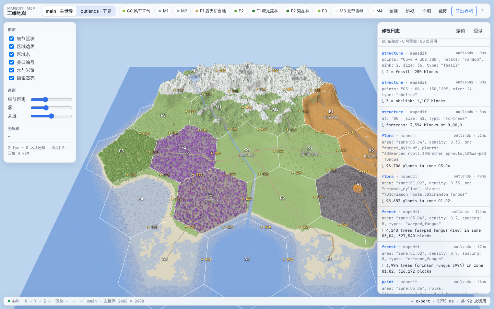
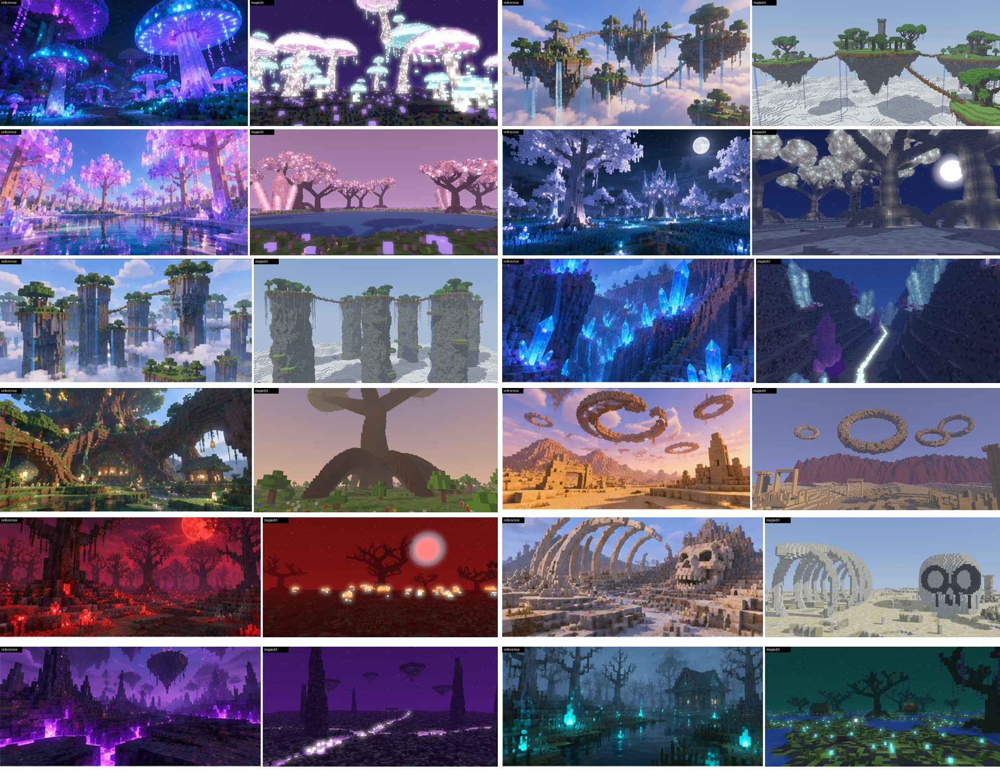
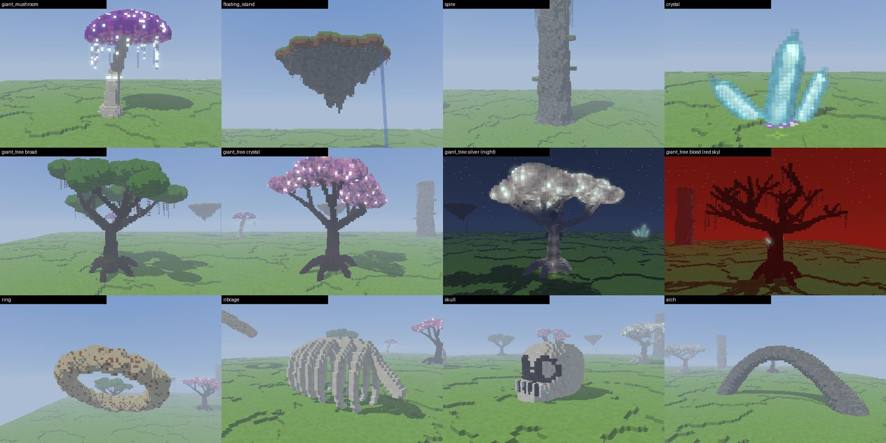
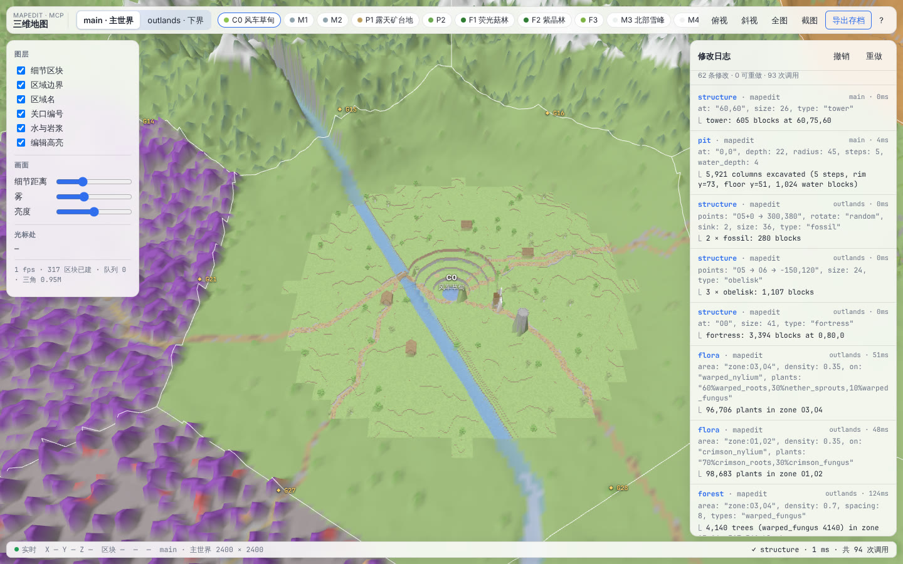
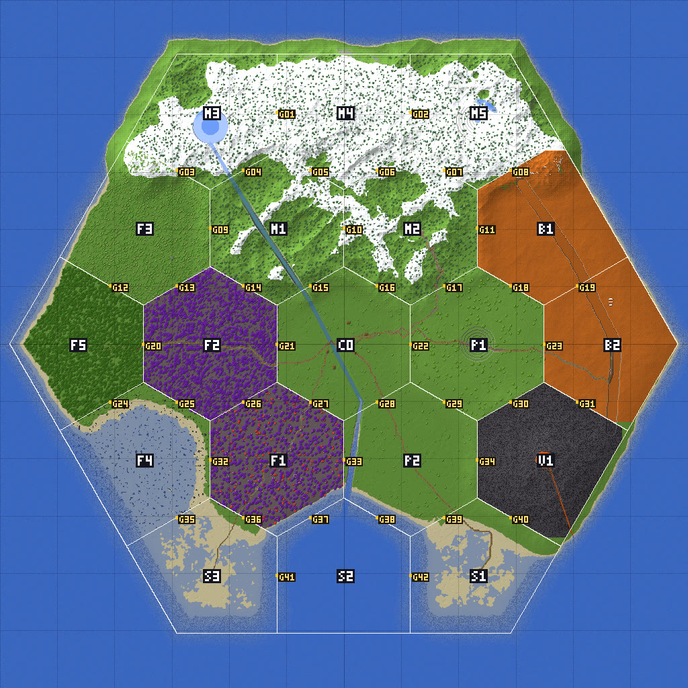
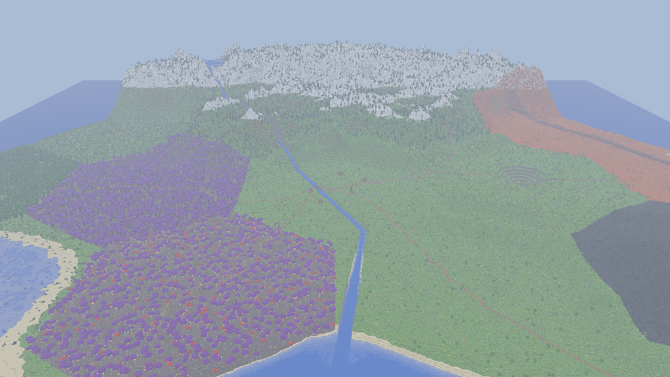

# mapedit — 给 AI 用的 Minecraft 实时地图编辑器

一个用 Rust 写的 Minecraft 地图编辑器，通过 **MCP** 让 AI Agent（Claude Code、Claude Desktop 或任何 MCP 客户端）直接生成和修改地形。每次编辑都会**实时**显示在浏览器的 3D 预览里，可以撤销，最后**导出成原版 Java 存档**，单人模式直接打开。

思路来自 B 站视频《给AI用的Minecraft实时地图编辑器》（拆解见 [`../docs/theworld-video-analysis.md`](../docs/theworld-video-analysis.md)），代码从零实现，并在几个方向上做得比视频更多（见下文「比原版多了什么」）。



## 快速开始

```bash
cd mapedit
cargo build --release          # 生成 target/release/mapedit（单文件，前端已内嵌）

# 跑一遍示例：2400×2400 外星峡谷世界 + 1600×1600 下界外域，92 次调用
./target/release/mapedit run examples/alien_canyon.json --serve
# 打开 http://localhost:8848/ 看 3D 预览；存档写到 ./exports/TheWorld
```

示例脚本在 4 核机器上大约 26 秒跑完。主世界写入约 9.1 亿个非空气方块，导出 52 个区域文件（主世界 36 个，下界 16 个）。

### 接入 Claude Code

```bash
claude mcp add mapedit -- /绝对路径/mapedit/target/release/mapedit mcp
```

然后直接对 Claude 说，例如：

> 在 2400×2400 的地图上做一个外星峡谷世界：北部雪山，一条断层峡谷和几个露天矿坑，河流向南流进大海，西边是紫色森林，旁边再做一个下界外域。做完导出存档。

`mcp` 模式下，3D 预览同时在 <http://localhost:8848/> 启动（端口被占用时会自动顺延，`--port` 可以指定，`--no-viewer` 可以关闭）。

### 接入 Claude Desktop / 其他客户端

stdio 方式（`claude_desktop_config.json`）：

```json
{ "mcpServers": { "mapedit": { "command": "/绝对路径/mapedit", "args": ["mcp"] } } }
```

HTTP 方式：先运行 `mapedit serve`，再把客户端指向 `http://localhost:8848/mcp`（Streamable HTTP，返回 JSON 响应）。

## 功能

### 49 个 MCP 工具

| 类别 | 工具 |
|---|---|
| 世界 | `world_create` `world_list` `world_info` `world_select` `world_delete` |
| 语义分区 | `zones_hex` `zone_set` `zones_list` —— 六边形区域 + 区域之间的关口（G01…），带地形预设 |
| WorldEdit 式 | `generate`（表达式）`box` `sphere` `cyl` `line` `replace` `biome` |
| Axiom 式笔刷 | `ridge`（山脊）`raise` `smooth` `flatten` `roughen` `terrace` `pit`（露天矿坑）`carve`（峡谷）`paint`（按高度/坡度/噪声规则上色）`overlay` |
| 水与路 | `river`（水位单调下降）`fill`（连通洪泛填海）`road`（坡度限制，过水自动架桥，`route:true` 用 A* 自动绕开陡坡） |
| 植被 | `forest`（17 种程序化树，成簇分布）`tree` `flora` |
| **奇幻生成器** | `feature`：巨型蘑菇、浮空岛、天柱、水晶簇、巨树（8 种风格）、浮空岩环、肋骨架、头骨、拱桥/巨根、吊桥、发光裂隙；可单点放置，也可按数量在区域里随机撒 |
| 结构 | `structure`（9 种程序化地标）`schem_load` `schem_save` `schem_list` `copy` `paste`（Sponge .schem v2/v3，带方块朝向的旋转） |
| **让 AI 看见** | `map`（俯视晕渲图，带区域边界和 ID 标注）`view`（体素光线追踪：悬空结构、玻璃、发光方块、Minecraft 规则的方块光传播、阴影、白天/黄昏/夜晚、天色、泛光）`probe` `stats` |
| 流程 | `history` `undo` `redo` `batch` `help` |
| 存档 | `export`（Anvil `.mca` + `level.dat`，多维度，`time:"night"` 可固定为永夜）`import`（读入已有 1.18+ 存档继续编辑） |

完整清单运行 `mapedit tools` 查看（共 49 个）。参数语法会在 MCP 初始化时通过 `instructions` 字段发给模型，模型也可以调用 `help` 工具查询。

### 给 AI 用的参数语法

```text
点      "x,y,z" | "x,z"(y 取地表) | 关口 "G03" | 区域 "F2" | 加高 "G03+2"
路径    "G01 → 120,300 → G08"
区域    "all" | "zone:F1,F2" | "F2" | "rect:x0,z0,x1,z1" | "circle:x,z,r" | "G03:60" | "outside"
方块    "stone" | "60%stone,30%andesite,10%gravel" | "oak_log[axis=x]"
掩码    "stone,dirt" | "!air" | "#solid" "#liquid" "#foliage" "#plant" "#wood" "#existing"
表达式  "y <= height(x,z)"   "y <= 64 + 20*fbm(x,z,150) && y > 0"
        函数：noise fbm ridged worley rand height(区域设计高度) edge(到区域边界距离) top(当前地表) …
```

`y <= f(x,z)` 这种形式的表达式会被识别成「按列填充」，2400×2400 的地形底子几秒就能生成。

## 从概念图到场景

`examples/scenes/` 下有 12 个脚本，把一组奇幻概念图（星孢森林、倒悬天境、琉璃幻林、永夜银森、天柱遗境、晶脉裂谷、世界树根域、浮环沙海、血月腐林、巨骸荒原、虚空蚀地、幽魂沼泽）复刻成了 Minecraft 场景。每个脚本 8–17 次调用，1–4 秒跑完。下图左边是参考图，右边是 `view` 从近似机位渲染的结果：



AI 的工作流程（已经写进 MCP 的 `instructions`）：

1. **拆解图片**：地形底子 → 主体奇观（`feature`）→ 批量点缀（`forest`、`flora`、`feature count=N`）→ 建筑 → 氛围（时间、天色、发光）。
2. **用同机位渲染对比**：`view` 设好 `camera` / `look_at` / `fov` / `time` / `sky` / `sun_azimuth` / `ambient`，和参考图并排比较。
3. **按「构图和比例 → 轮廓 → 颜色和光」的顺序修正最大的差距**，再渲染，重复。

发光效果用的都是游戏里真实可用的做法：发光方块（海晶灯、蛙明灯、菌光体、哭泣的黑曜石），染色玻璃盖在发光层上（发光的菌盖、紫色熔流），以及不可见的 `light` 方块（生成器会自动布置，夜里在游戏中也会亮）。渲染器按 Minecraft 的规则计算方块光传播，所以预览里看到的亮暗和游戏里基本一致。

生成器一览（`help topic=features` 可以查看全部参数）：



```bash
./target/release/mapedit run examples/scenes/04_silver_night.json --serve   # 任选一个场景
```

已知差距：参考图是 AI 生成的写实风格渲染，带体积光、倒影和景深，这些在方块世界里无法一比一还原；`view` 也不会渲染倒影，并且用的是纯色而不是方块贴图。另外，自定义群系（用来改天空和雾的颜色，比如真正的血红天空）的数据包格式我没能核实，所以还没有做；目前天色只在 `view` 预览里生效，游戏里需要配合资源包或光影。

## 比原版多了什么

1. **AI 能看见自己的结果**：`map` 返回带区域/关口文字标注的俯视图（内置像素字体），`view` 返回任意机位的 3D 透视图。两者都是 MCP 的图片内容，模型可以按「规划 → 执行 → 看 → 修正」的循环工作，不用像视频里那样只拿到一个方块数。
2. **语义锚点**：区域和关口都能直接当作点、路径和区域参数使用，修路写 `"F5 → F2 → C0 → P1"` 就行。
3. **道路自动寻路**：`road route:true` 在地形上做 A* 搜索，代价函数考虑坡度和过水，然后平滑路径、限制坡度，过水自动架桥。
4. **真正的撤销/重做**：基于区块快照，区域划分的修改也能撤销；编辑失败会自动回滚；历史按快照内存（2 GB）和条数（500）限制。
5. **导入已有存档**：可以在现有世界上继续编辑，不只是从零生成。
6. **`batch` 批量调用**：一次请求执行多步编辑，每步仍然是独立的撤销点。
7. **stdio 和 HTTP 两种 MCP 传输**，预览页面也能直接调用工具（撤销、导出）。

## 3D 预览



- 全图用降采样的 LOD 高度网格显示，相机附近按需加载逐方块的细节区块（面剔除、按面方向烘焙明暗、水体半透明）
- 通过 WebSocket 推送脏区块：Agent 每次编辑后，只重建被改动的区块，并用橙色框高亮编辑范围
- 区域边界、区域名和关口编号叠加显示；点击顶栏的区域按钮可以飞过去
- 左侧：图层开关、细节距离/雾/亮度、光标处的方块/区域/群系；右侧：修改日志、撤销、重做；导出存档对话框带进度条
- 快捷键：`T` 俯视，`O` 斜视，`F` 全图，`Ctrl/⌘+Z` 撤销，双击飞到该点

AI 侧拿到的图片：

| `map` | `view` |
|---|---|
|  |  |

## 存档导出说明

- 区块按 1.18+ 的分段调色板格式写入，默认 `DataVersion 4189`（1.21.4）。更新的游戏版本打开时，会通过 DataFixerUpper 自动升级区块（游戏会先提示备份）。目标版本可以用 `data_version` 和 `version_name` 参数指定。
- 不写光照（`isLightOn = 0`），由游戏在加载时重算。高度图也由游戏重算。
- 地图以外用虚空超平坦生成器，所以存档边界外是空的。
- 维度映射：第一个主世界 → `region/`，`the_nether` 世界 → `DIM-1/`，其他世界 → 数据包里的自定义维度（`mapedit:<名字>`，用 `/execute in mapedit:<名字> run tp @s 0 100 0` 进入）。
- 群系只接受原版 ID，非原版的群系在导出时会回退成 `plains`。

### 游戏内验证结果

用原版服务端（1.21.4 和最新的 26.3）加载导出的存档，再把游戏重新保存的结果逐方块对比（工具在 [`tools/mc-verify/`](tools/mc-verify/README.md)）：

| 测试 | 1.21.4 | 26.3 |
|---|---|---|
| 启动并加载存档，日志无区块错误 | ✓ | ✓ |
| 11 个数据包自定义维度全部加载 | ✓ | ✓ |
| 2400×2400 大世界强制升级（32,500 区块） | 无需升级 | ✓ 23 秒 |
| 主世界 + 下界 10.46 亿个非空气方块逐个对比 | — | **完全一致** |
| 12 个概念图场景约 2.67 亿方块逐个对比 | **完全一致** | 一致（仅 `chain` 被游戏改名为 `iron_chain`） |
| 永夜（时间 18000，日夜循环关闭） | ✓ | ✓（迁移成新规则 `advance_time=false`） |

还用 100 倍随机刻跑了 60 秒（约等于正常游戏一个多小时），并对瀑布触发方块更新，观察玩起来会怎样：

- 被方块盖住的第二层草方块/菌丝体会变成泥土（玩家看不到，属于正常规则）。
- 瀑布柱本身稳定，只在落到地面时向四周溅开。
- 这次测试抓出并修掉了三个真问题：天柱的藤蔓没有附着方向会全部消失（已改为贴着岩壁并设置朝向）；垂根不能一节挂一节（浮空岛的垂根改成 1 格）；洞穴藤蔓挂在树叶下会掉落（树冠下的垂挂物改用苍白垂苔）。修复后这三个场景没有任何方块消失。
- 同时修好了 mapedit 导入 26.x 存档的问题：新版把维度搬进了 `dimensions/minecraft/...`，调色板键名从 `Name/Properties` 改成了 `id/properties`，运行时还会存成纯字符串或 `{"": ...}`。

尚未验证：在真实客户端里的画面效果（贴图、原版光照）。

## 架构

```
src/
  blocks.rs   方块状态驻留注册表（u16 id）、分类、地图颜色
  world.rs    有界区块网格；16³ 分段，Uniform / 8 位调色板 / Raw 三种存储；撤销日志；脏区块跟踪
  zones.rs    六边形区域、关口、地形预设、混合后的设计高度场
  expr.rs     表达式解析和求值，按列形式识别
  spec.rs     点 / 路径 / 区域 / 方块模式 / 掩码的解析
  noise.rs    Perlin、fBm、ridged、Worley、RNG
  ops/        terrain.rs  water.rs  nature.rs  structures.rs  fantasy.rs（奇幻生成器）  mod.rs（形状、generate、高度图读写）
  anvil.rs    .mca / level.dat 导出导入，自定义维度数据包
  render.rs   给 AI 的 PNG：晕渲俯视图（+ 旧的高度场透视图）
  raytrace.rs 体素光线追踪：DDA、空区段跳过、半透明、块光泛洪、阴影、泛光
  mesh.rs     预览用的二进制区块网格和概览网格
  editor.rs   多世界会话、历史、事件
  tools.rs    49 个工具的 schema 和实现，以及给模型的 instructions
  mcp.rs      JSON-RPC MCP（stdio + HTTP 共用）
  server.rs   axum：预览页面、/api/*、/ws、/mcp
web/          index.html + app.js（three.js 0.170 已内嵌在 web/vendor）
```

所有编辑都在内存里用 rayon 按区块并行执行，不经过游戏服务端，也不受 tick 限制。

## 测试

```bash
cargo test --release
```

共 14 个测试，包括一个端到端测试：在小世界上依次调用每个编辑工具和全部 11 种奇幻生成器，渲染夜景，验证撤销/重做、批处理、失败回滚，以及导出→导入后方块逐一对比。

## 后续可以做

- 在游戏里实时同步（Fabric 模组通过 WebSocket 接收脏区块）
- 脚本工具（在沙箱里执行 Rhai/JS），把 49 个原子工具组合成任意操作
- 水力侵蚀模拟，以及更多程序化建筑（波函数坍缩生成村庄/城堡）
- 预览和 `view` 改用 Minecraft 贴图（运行时从用户本机的游戏 jar 读取），加贪心网格合并；`view` 增加水面倒影
- 核实格式后，导出自定义群系数据包（天空、雾、水的颜色，粒子效果）
- 更多建筑生成器：哥特尖塔神殿、高脚屋、沙漠遗迹群
- 从参考图自动提取主色调并匹配方块调色板
- 方块实体（箱子、告示牌）和自定义群系的数据包
